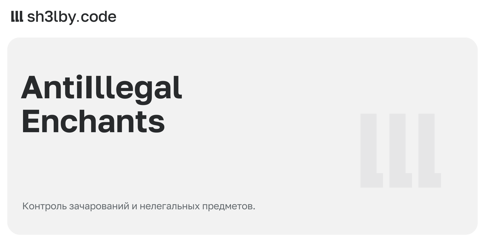

# AntiIllegalEnchants

<!-- portfolio-card:start -->
[](docs/portfolio/card.svg)
<!-- portfolio-card:end -->

Предмет с запрещённым зачарованием должен обрабатываться по правилам сервера. AntiIllegalEnchants проверяет уровни, совместимость чар и допустимость зачарования для конкретного предмета. Администратор задаёт ограничения и исключения в YAML.

Это задача на границе игровых правил и модерации: обнаружить нелегальный предмет, выбрать действие и оставить запись о том, что произошло.

## Как применяются правила

- Проверки привязаны к событиям: входу игрока, действиям с инвентарём, подбору, крафту и другим операциям. Отдельно обрабатываются выпавшие предметы при загрузке чанка.
- Плагин проверяет и содержимое шалкеров и мешков. Разрешённые авторские предметы можно исключить по материалу, имени, CustomModelData или PDC-ключу.
- Режим обработки задаётся в `settings.action`: `DELETE`, `STRIP`, `REPLACE` или `LOG_ONLY`. По умолчанию выбран `DELETE`, который удаляет предмет.
- Администратору доступны `/aie scan <player>`, `/aie scanall`, `/aie reload` и `/aie debug`. Действия можно записывать в файл и сопровождать уведомлениями.

Правила проверки отделены от обработки событий и изменения предметов. Их поведение проверяется тестами с MockBukkit. Текущая реализация исключает элитры из проверки и игнорирует проклятие утраты; эти границы важны при настройке правил сервера.

Обсудить похожий проект: [sh3l.beer](https://sh3l.beer).

## Сборка

```bash
mvn package          # runs the MockBukkit test suite, produces target/anti-illegal-enchants-1.0.0.jar
```

Нужны Java 21 и сервер Paper 1.21.

## Структура проекта

```
src/main/java/dev/sh3lby/antiillegalenchants/
  check/      EnchantCheckService, CheckResult
  action/     ItemScanService, actions
  listener/   join / pickup / inventory / open listeners
  config/     ConfigManager
  command/    /aie
  log/        action log
src/test/java/...  EnchantCheckServiceTest (MockBukkit)
docs/techtask.md   original spec (RU)
```

## Лицензия

MIT
